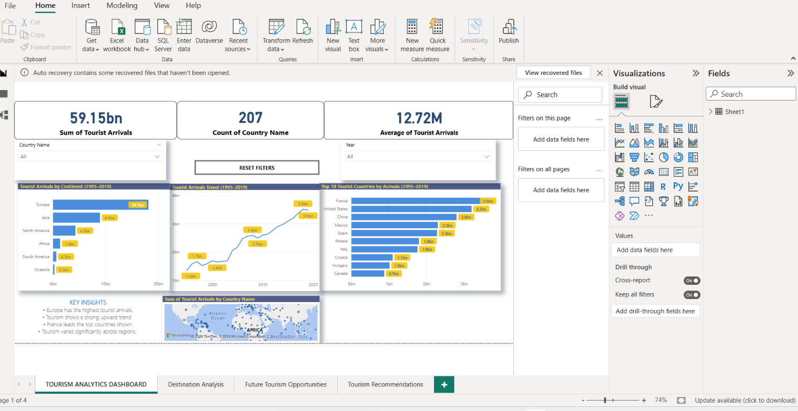
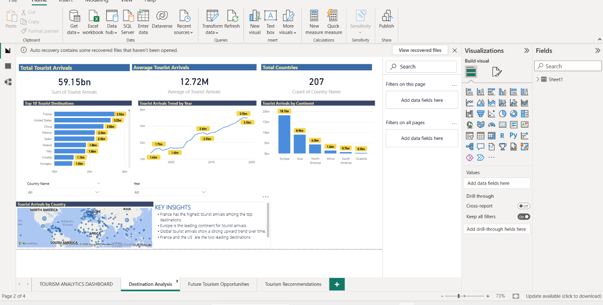
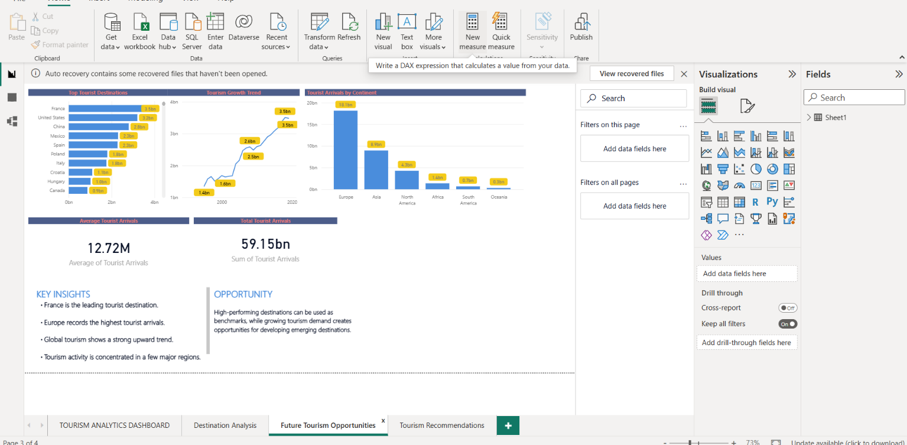
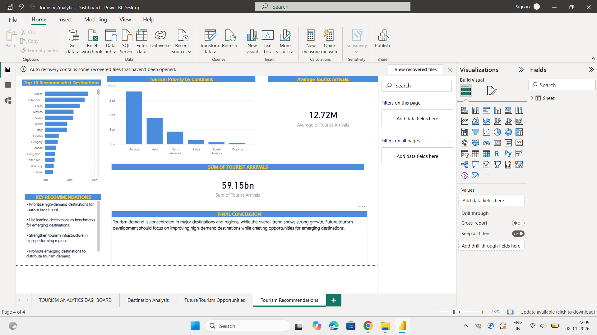

# Tourism Analytics: Identifying High-Impact Destinations

## Project Overview
This project analyzes international tourism data to identify
popular destinations, understand tourism trends, and discover
opportunities for future tourism development.

The project uses Excel, SQL, Python and Power BI to transform
tourism data into meaningful insights.

## Technologies Used
- Microsoft Excel – Data collection and cleaning
- SQL – Data querying and analysis
- Python – Data analysis
- Pandas – Data manipulation
- Matplotlib – Data visualization
- Power BI – Interactive dashboards
- Jupyter Notebook – Python development

## Project Workflow
1. Collected international tourist arrivals data.
2. Cleaned and prepared the dataset using Excel.
3. Analyzed tourism data using SQL.
4. Performed Python analysis using Pandas.
5. Created visualizations using Matplotlib.
6. Developed interactive dashboards using Power BI.
7. Identified tourism trends and development opportunities.

## Power BI Dashboard

The dashboard contains four pages:

1. Tourism Analytics Dashboard
2. Destination Analysis
3. Future Tourism Opportunities
4. Tourism Recommendations

## Dashboard Screenshots

### Main Dashboard

### Destination Analysis

### Future Tourism Opportunities

### Tourism Recommendations

## Python Analysis

The Python notebook focuses on comparing international
tourist arrivals in 2019 and 2020.

Key findings:
- 2019 total arrivals: 1,900,455,200
- 2020 total arrivals: 618,504,300
- Overall decline: 67.45%

## Project Files
- Tourism_Analytics_Pandas.ipynb
- Tourist_Arrivals_Cleaned_New.xlsx
- tourism_analysis_final.sql
- Tourism_Analytics_Dashboard.pbix

## Conclusion
This project demonstrates an end-to-end data analytics
workflow, from data preparation and analysis to interactive
visualization and business recommendations.
